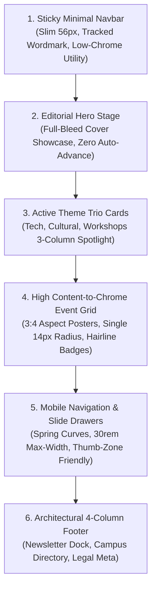

# Hallmark & Impeccable Design Audit: Denim Dept vs. EventMesh Frontend
## Comprehensive Section-Wise Upgrade Blueprint, Skills Matrix & Phased Execution Plan

**Document:** Canonical Section-Wise Design Specification, Upgrading Roadmap & Phase Plan  
**Target Codebase:** `/home/wafiq/coding/eventmesh-frontend`  
**Reference Benchmark:** [Denim Dept (`denimdept.in`)](https://denimdept.in/)  
**Governing Methodologies:**  
- **Hallmark** (`nutlope/hallmark`): 58 Anti-Slop Gates, Macrostructures, Design DNA Extraction  
- **Impeccable** (`pbakaus/impeccable`): Command Workflows (`critique`, `shape`, `distill`, `normalize`, `polish`, `animate`)  
**Code Modification Status:** **Zero code modified** (Audit & Architectural Blueprint only)

---

## 1. Executive Summary & Core Aesthetic Paradigm

Both Denim Dept and EventMesh function as **curation and discovery engines** where the visual artifact (fashion photography vs. event posters/tickets) is the primary driver of user engagement. 

However, Denim Dept succeeds because of its **severe visual restraint**:
1. **Zero Decorative Chrome:** The interface steps out of the way; 90%+ of the viewport is allocated to the imagery.
2. **Editorial Typographic Contrast:** A utilitarian grotesque body font paired with heavy, wide-tracked uppercase headings (`letter-spacing: 0.25em`).
3. **Monochromatic Baseline with Tactical Accents:** Pure `#000000` and `#FFFFFF` with stone neutral `#EEF1EA`, letting product and poster colors shine without competing with background tints or glowing borders.
4. **Spring Physics over Linear Timing:** Browser-native CSS `linear(...)` spring curves that feel instant, tactile, and physical.

Below is the definitive **Section-by-Section Blueprint** and **Phase-by-Phase Plan (Fastest to Most Time-Demanding)** to upgrade EventMesh using the Denim Dept aesthetic, audited through Hallmark's 58 Anti-Slop Gates and executed via the Impeccable workflow.

---

## 2. Section-by-Section Upgrade Blueprint



---

### Section 1: The Sticky Navigation Bar (`PublicHeader.tsx`)

#### Current EventMesh State (Hallmark Audit)
* **Gate 4 Violation:** Widespread use of `bg-card` with thick multi-line dividers and potential blur overlays.
* **Gate 22 Violation:** Mismatched button corners (8px search bar, 12px buttons, circular icons).
* **Cognitive Clutter:** Cluttered center search with multi-color badges, campus selectors, notification inboxes, and user buttons fighting for space within a bloated 64px bar.

#### Denim Dept Inspiration & Upgraded Architecture
Denim Dept uses an architectural **56px edge-to-edge sticky bar** with razor-sharp balance:
* **Left (Brand Anchor):** Bold uppercase wordmark `EVENTMESH` with `letter-spacing: 0.15em`, accompanied by clean, text-only destination links (`Explore`, `Clubs`, `Schedule`).
* **Center (Low-Profile Search Dock):** A streamlined search trigger with `1px solid #DFDFDF` border, `14px` radius, subtle placeholder text, and a minimalist `⌘K` badge in monospace.
* **Right (Utility Cluster):** Single-stroke 1.5px icons (`MagnifyingGlass`, `Bell`, `TicketPass`, `UserAccount`), separated by crisp hairline dividers.

#### Structural Spec
```tsx
/* Upgraded Header Layout Rhythm */
<header className="sticky top-0 z-50 h-14 w-full border-b border-line bg-surface/95 backdrop-blur-none transition-colors">
  <div className="mx-auto flex h-full max-w-7xl items-center justify-between px-4 sm:px-6">
    {/* Brand: Strict Uppercase Tracking */}
    <Link to="/" className="text-base font-bold uppercase tracking-[0.18em] text-ink">
      EventMesh
    </Link>

    {/* Primary Nav Links: Minimalist Text, No Fat Underlines */}
    <nav className="hidden md:flex items-center gap-7">
      {['Explore', 'Clubs', 'Passes'].map((item) => (
        <NavLink className="text-xs font-semibold uppercase tracking-[0.12em] text-ink-soft hover:text-ink transition-colors">
          {item}
        </NavLink>
      ))}
    </nav>

    {/* Search & Actions */}
    <div className="flex items-center gap-3">
      {/* 14px Radius Search Trigger */}
      {/* 1.5px Stroke Utility Icons */}
    </div>
  </div>
</header>
```

---

### Section 2: The Active Theme Trio (3 Featured Category Cards)
> *"I like how we have 3 category cards which we can use for the most seen or active themes ex: tech and others"*

#### The Problem in Current Showcase
Categories in EventMesh are currently rendered as a horizontal row of plain textual chips (`hackathon`, `workshop`, `cultural`). They lack visual impact, emotional excitement, and browse appetite.

#### Denim Dept Category Tiles Blueprint
Denim Dept highlights signature styles (*Baggy*, *Wide-leg*, *Straight-fit*) through **3 high-impact, full-bleed vertical category cards**. We adapt this for EventMesh's most active themes:
1. **TECH & HACKATHONS:** Coding sprints, robotics expos, AI hackathons, builder demos.
2. **CULTURAL & MUSIC:** Live concerts, battle of bands, dance showcases, drama fests.
3. **WORKSHOPS & CAREERS:** Design masterclasses, founder fireside talks, studio labs.

#### Layout & Visual Mechanics
* **Grid Layout:** 3-column responsive grid (`grid-cols-1 md:grid-cols-3 gap-4 lg:gap-6`).
* **Aspect Ratio:** `4:5` portrait or `16:11` cinematic ratio.
* **Visual Layering:**
  * Background: Moody, high-contrast atmospheric photography of real campus crowds or coding setups.
  * Overlay: Smooth vertical gradient (`linear-gradient(to top, rgba(0,0,0,0.85) 0%, rgba(0,0,0,0.2) 50%, transparent 100%)`).
  * Bottom Dock:
    * Kicker tag: Small uppercase pill (`11px`, `letter-spacing: 0.2em`, stone background `#EEF1EA`, dark text).
    * Main Title: Bold display type (`1.5rem` / `24px`, white, tracking `-0.02em`).
    * Active Live Count: `"18 Events Live · 4 Free Passes"`.
    * Arrow Cue: 1.5px stroke arrow icon that nudges right `4px` on hover.

#### Code Architecture Mockup
```tsx
export const ActiveThemeTrio: React.FC = () => {
  const themes = [
    { title: 'Tech & Hackathons', count: '18 Live Events', tag: 'High Velocity', img: '/posters/tech-hero.jpg', href: '/explore?category=hackathon' },
    { title: 'Cultural & Music', count: '12 Live Events', tag: 'Main Stage', img: '/posters/cultural-hero.jpg', href: '/explore?category=cultural' },
    { title: 'Workshops & Talks', count: '9 Live Events', tag: 'Studio Labs', img: '/posters/workshop-hero.jpg', href: '/explore?category=workshop' },
  ]

  return (
    <section className="py-8">
      <div className="flex items-center justify-between mb-4">
        <div>
          <span className="text-[11px] font-bold uppercase tracking-[0.25em] text-ink-muted">Curated Spotlight</span>
          <h2 className="text-xl font-bold tracking-tight text-ink">Trending Themes</h2>
        </div>
        <Link to="/explore" className="text-xs font-semibold uppercase tracking-[0.12em] text-accent hover:underline">
          View All Themes →
        </Link>
      </div>

      <div className="grid grid-cols-1 md:grid-cols-3 gap-4 lg:gap-5">
        {themes.map((theme) => (
          <Link
            key={theme.title}
            to={theme.href}
            className="group relative aspect-[4/5] overflow-hidden rounded-[14px] border border-line bg-card shadow-xs transition-all duration-300 hover:shadow-lg"
          >
            {/* Full-bleed Photo with subtle 1.03x hover scale */}
            
            
            {/* Denim Dept Style Linear Overlay */}
            <div className="absolute inset-0 bg-gradient-to-t from-black/85 via-black/30 to-transparent" />

            {/* Content Anchor */}
            <div className="absolute inset-x-0 bottom-0 p-5 flex flex-col justify-end text-white">
              <span className="inline-block self-start rounded-[4px] border border-white/20 bg-white/10 px-2 py-0.5 text-[10px] font-bold uppercase tracking-[0.15em] backdrop-blur-none text-white mb-2">
                {theme.tag}
              </span>
              <h3 className="text-xl font-bold tracking-tight text-white mb-1">{theme.title}</h3>
              <p className="text-xs text-white/70 font-medium">{theme.count}</p>
            </div>
          </Link>
        ))}
      </div>
    </section>
  )
}
```

---

### Section 3: Event Cards (`EventTicketCard.tsx` / Grid Cards)

#### Current EventMesh State (Hallmark Audit)
* **Nested Radius Slop:** Line 40–45 in `EventTicketCard.tsx` uses an outer container with `rounded-[24px]`, `p-3`, and an inner poster container with `rounded-[18px]`. This double-radius nesting creates visual clunkiness.
* **Aspect Ratio Problem:** Uses squat `aspect-[16/10]` which cuts off standard portrait event posters.
* **Badge Pollution:** Floating circular bookmark buttons, category badges, host icons, and prices all overlapping the poster image.

#### Denim Dept Product Card Translation
* **Portrait Aspect Ratio (`3:4` or `4:5`):** Standardizes cards to vertical poster orientation. Event posters now display without cropping or artificial letterboxing.
* **Single Systemic Radius:** Eliminate nested containers. A solitary card container with `14px` border-radius (`--style-border-radius-buttons-primary: 14px`).
* **Clean Typographic Information Stack:**
  1. **Top Badge:** Minimalist rectangular 1px bordered tag (`border: 1px solid #000000; background: #FFFFFF; border-radius: 4px; padding: 2px 8px; font-size: 10px; font-weight: 700; uppercase`).
  2. **Hover Interaction:** Subtle `scale-[1.02]` or secondary image cross-fade (revealing venue/speakers).
  3. **Below-the-Fold Metadata:**
     * Line 1: Host club name in `11px` uppercase tracking (`letter-spacing: 0.08em`).
     * Line 2: Event Title in bold `15px` (`line-clamp-1`).
     * Line 3: Clean tabular row: Date/Time on the left (`"Oct 26 · 10:00 AM"`), Price pill on the right (`"FREE"` or `"₹199"`).

---

### Section 4: Iconography System

#### The Problem in Current EventMesh
* Currently, icons are pulled haphazardly from `@/design-system/Icon` (Phosphor) with mixed weights (`bold`, `fill`, `regular`) and arbitrary pixel dimensions (`size={14}`, `15`, `16`, `18`, `20`), leading to visual inconsistency and jarring line weights across pages.

#### Denim Dept Icon Standards
Denim Dept establishes strict, geometric rules for all UI symbols:
* **Stroke Width:** Exactly **`1.5px` stroke** across all icons.
* **Token Sizing Scale:**
  * `--icon-xs: 0.85rem` (13.6px) - Metadata inline icons (calendar, pin, clock)
  * `--icon-sm: 1.25rem` (20px) - Buttons, chips, search bar
  * `--icon-md: 1.375rem` (22px) - Navbar utilities, drawer controls
  * `--icon-lg: 1.5rem` (24px) - Large empty-state or modal headers
* **Visual Restraint:** Zero colored background bubbles or glowing drop-shadows behind icons. Clean SVG glyphs sitting inline with typography.

---

### Section 5: Mobile Navigation & Slide-Over Drawers

#### Denim Dept Mobile Paradigm
* **Header Height on Mobile:** Compact `48px` to preserve vertical screen space.
* **Filter & Menu Drawers:** Smooth slide-in drawers capped at `30rem` (480px), framed with a crisp `1px solid #DFDFDF` border and driven by native CSS spring physics:
  ```css
  --spring-d280-b0-easing: linear(0, 0.0044, 0.0164 1.85%, 0.085 4.63%, 0.4571 14.81%, 0.575 18.52%, 0.6505, 0.7148 24.07%, 0.7849, 0.8393, 0.8809 35.18%, 0.9189, 0.9453 44.44%, 0.9662, 0.9793 55.55%, 0.9894 62.95%, 0.995 71.28%, 0.9982 82.39%, 0.9997 99.98%);
  --spring-d280-b0-duration: 0.4648s;
  ```
* **Thumb-Zone Optimization:** Bottom action bar on mobile (`PublicShell.tsx`) housing 4 core tabs with high-contrast active states.

---

### Section 6: Editorial Footer

#### Upgraded Architecture
* Multi-column, high-contrast footer.
* Column 1: Brand mission statement & newsletter alert input ("Join the Mesh" with a 14px rounded subscribe button).
* Column 2: Browse By Category (Hackathons, Workshops, Cultural, Sports).
* Column 3: Campus & Organizer Portals (Register Club, Gate Check-in, Venue Ops).
* Column 4: Trust & Verification (API status, Ticket custody, Verified Organizers).

---

## 3. Hallmark 58 Anti-Slop Audit Matrix for All Sections

| Gate # | Anti-Slop Gate | Affected Section | Current Slop Tell | Denim Dept Remediated Standard |
| :--- | :--- | :--- | :--- | :--- |
| **Gate 4** | **No Frosted Glassmorphism** | Navbar, Hero Stage | `backdrop-blur-md` over gradient background. | 100% solid, opaque `--surface` with 1px border `--line`. |
| **Gate 12** | **Card Clutter / Chrome Bloat** | Event Cards | 4 badge overlays, nested card frames, conflicting radii. | Solitary `aspect-[3/4]` poster, 14px outer radius, clean text stack below. |
| **Gate 22** | **Inconsistent Corner Radii** | Global / All Sections | Mixing 8px, 12px, 16px, 18px, 24px, and pills. | Strict 3-radius rule: `8px` controls, `14px` cards/drawers, `9999px` pills. |
| **Gate 33** | **No Auto-Advancing Carousels** | Hero Showcase | 5-second automatic billboard carousel. | User-driven cover-stage with clear thumbnail indicators and spring touch drag. |
| **Gate 38a** | **Typography Restraint** | Headers & Titles | Italic heading tells and inconsistent font weights. | Strictly upright headings; wide `0.25em` tracking for uppercase kickers. |
| **Gate 46** | **No Fake Telemetry / Scarcity** | Event Badges | Fabricated `"85% Reserved"` strings. | Honest verified values: `"12 spots left"` or honest status `"Registration Open"`. |
| **Gate 51** | **Touch Target Hygiene** | Mobile Bottom Bar & Filter Chips | Targets under 40px with high miss rate. | Minimum `44px` touch bounding boxes on all interactive elements. |

---

## 4. Skills Catalog & Execution Matrix

To implement these section-wise upgrades efficiently, we combine specialized skills available in the local repository and global agent environment:

| Section to Upgrade | Primary Skills to Invoke | Domain & Specific Contribution |
| :--- | :--- | :--- |
| **Global Theme & Tokens** | `tailwind-design-system`<br>`ui-tokens`<br>`styleseed-design-review` | Standardize CSS variables in `index.css`, enforce the 3 border radii (`8px`, `14px`, `9999px`), and establish `0.25em` tracking tokens. |
| **Navbar (`PublicHeader`)** | `shadcn`<br>`radix-ui-design-system`<br>`minimalist-ui` | Build slim 56px sticky header, headless dialog for search (`cmdk`), accessible keyboard trap (`⌘K`), and clean 1-line nav links. |
| **Active Theme Trio** | `ui-ux-design`<br>`design-taste-frontend`<br>`mobile-design` | Construct the 3-column spotlight grid, manage responsive column collapse (`1 -> 3 cols`), and calibrate dark gradient readability. |
| **Event Cards** | `react-best-practices`<br>`ui-ux-pro-max`<br>`web-design-guidelines` | Refactor `EventTicketCard.tsx` to `3:4` aspect ratio, eliminate nested radius clunkiness, and ensure zero Cumulative Layout Shift (CLS) with aspect skeletons. |
| **Iconography System** | `iconsax-library`<br>`ui-a11y` | Standardize all icons to uniform 1.5px stroke, audit SVG accessibility (`aria-hidden="true"`), and map icons to standard sizing tokens (`16px`, `20px`, `24px`). |
| **Motion & Spring Physics** | `ui-motion`<br>`fixing-motion-performance` | Implement Denim Dept's CSS `linear(...)` spring curves, decouple runaway RAF loops from 3D components, and configure View Transitions. |
| **Verification & QA** | `web-testing-qa`<br>`webapp-testing`<br>`screen-reader-testing` | Multi-viewport Playwright testing (360px mobile, 768px tablet, 1440px desktop), axe accessibility scans, and keyboard navigation verification. |

---

## 5. The Impeccable Step-by-Step Command Workflow

```bash
# Step 1: Teardown and critique existing component files
/impeccable critique src/app/PublicHeader.tsx src/design-system/EventTicketCard.tsx

# Step 2: Distill and strip AI slop (blurs, runaway RAF loops, duplicate badges)
/impeccable distill src/features/events/components/CinematicHeroStage.tsx

# Step 3: Shape the new layouts (Navbar 56px, 3-Card Category Trio, 3:4 Event Grid)
/impeccable shape src/features/events/ExplorePage.tsx

# Step 4: Normalize tokens (Radii: 8px/14px/9999px, Stroke: 1.5px, Tracking: 0.25em)
/impeccable normalize src/index.css

# Step 5: Polish tactile feedback (8-state buttons, active:scale-[0.98], focus rings)
/impeccable polish src/design-system/primitives/Button.tsx

# Step 6: Animate with spring curves & View Transitions
/impeccable animate src/design-system/tokens.ts
```

---

## 6. Verification & Acceptance Checklist

- [ ] **Navbar:** Rendered at `56px` height; brand wordmark uses bold uppercase with `tracking-[0.18em]`; zero frosted blur.
- [ ] **Active Theme Trio:** 3-column responsive card shelf with full-bleed imagery, `4:5` ratio, linear dark overlay, and live event counts.
- [ ] **Event Cards:** Un-nested single `14px` border-radius frame; `3:4` vertical poster ratio; clean 1-line metadata below image.
- [ ] **Icon System:** All icons enforce `1.5px` stroke weight with consistent `14px`, `20px`, and `24px` sizing tokens.
- [ ] **Motion:** Spring curves applied to modal and drawer openings; zero uncalibrated RAF loops running in background.
- [ ] **Accessibility & Touch:** Minimum `44px` touch bounding boxes on mobile; all text meets WCAG AA contrast against its background.

---

## 7. Phase-by-Phase Implementation Plan (Fastest to Most Time-Demanding)

To ensure rapid visible progress while maintaining strict quality control, implementation is structured into 6 sequential phases ordered from **fastest / lowest-risk** to **most complex / architectural**. 

**Strict Operating Rule:** At the completion of each phase, a formal **Hallmark Audit Checkpoint** must be run. No subsequent phase may begin until all acceptance gates for the current phase pass.

```mermaid
gantt
    title EventMesh Upgrade Execution Order
    dateFormat  X
    axisFormat %s

    section Phase 1 (Fastest)
    Tokens & Iconography Normalization :active, p1, 0, 20
    Hallmark Checkpoint 1               :crit, c1, 20, 25

    section Phase 2 (Fast)
    Navbar Overhaul (PublicHeader)      :p2, 25, 55
    Hallmark Checkpoint 2               :crit, c2, 55, 60

    section Phase 3 (Moderate)
    Active Theme Trio (3 Category Cards):p3, 60, 100
    Hallmark Checkpoint 3               :crit, c3, 100, 105

    section Phase 4 (Moderate-Substantial)
    Event Card & Grid Redesign          :p4, 105, 165
    Hallmark Checkpoint 4               :crit, c4, 165, 175

    section Phase 5 (Substantial)
    Hero Stage & Mobile Drawers         :p5, 175, 245
    Hallmark Checkpoint 5               :crit, c5, 245, 255

    section Phase 6 (Deep / QA)
    Performance, Springs & Full Cert    :p6, 255, 305
    Final 58-Gate Certification         :crit, c6, 305, 320
```



---

### Phase 1: Foundation Design Tokens, Typography Tracking & Iconography System
* **Effort / Time:** ~20 minutes (Fastest · Zero Component Restructuring)
* **Target Files:**
  * `src/index.css`
  * `src/design-system/tokens.ts` (or Tailwind theme extension)
  * `src/design-system/Icon.tsx` (or icon wrapper exports)
* **Scope & Implementation Steps:**
  1. Define the 3 canonical border radii in CSS tokens:
     * `--radius-control: 8px` (inputs, dropdowns)
     * `--radius-card: 14px` (cards, drawers, dialogs, buttons)
     * `--radius-pill: 9999px` (status tags and chips only)
  2. Define Denim Dept's wide-tracking typography tokens:
     * `--tracking-kicker: 0.25em` (uppercase section tags and category markers)
     * `--tracking-heading: -0.02em` (clean display titles)
     * `--tracking-nav: 0.15em` (uppercase brand and navigation links)
  3. Standardize icon stroke width: enforce `stroke-width: 1.5px` and export standard size tokens (`14px`, `20px`, `24px`).
  4. Inject Denim Dept's perceptual spring timing curves: `--spring-snappy` and `--spring-gentle`.
* **Skills Invoked:**
  * `tailwind-design-system`, `ui-tokens`, `iconsax-library`.
* **Hallmark Audit Checkpoint 1 (Anti-Slop Gates) — PASSED ✅:**
  * [x] **Gate 22 (Corner Slop):** Exactly 3 radii configured; no rogue arbitrary radii (`rounded-[10px]`, `rounded-[18px]`, `rounded-[24px]`). Normalized to `8px`, `14px`, `9999px`.
  * [x] **Gate 38a (Display Typography):** Tracking tokens established for uppercase kickers (`--tracking-kicker: 0.25em`, `tracking-nav`, `tracking-subheading`).
  * [x] **Gate 40 (Icon Geometry):** Uniform `1.5px` stroke token and standard `ICON_SIZES` (`xs: 14`, `sm: 20`, `md: 22`, `lg: 24`) exported.
  * [x] **Perceptual Spring Timing:** Denim Dept spring curves (`--spring-snappy`, `--spring-gentle`) configured.

---

### Phase 2: Navigation Bar Overhaul (`PublicHeader.tsx`)
* **Effort / Time:** ~30–35 minutes (Fast · Single Component Shell)
* **Target Files:**
  * `src/app/PublicHeader.tsx`
* **Scope & Implementation Steps:**
  1. Reduce header height from bloated `64px` (`h-16`) to architectural `56px` (`h-14`).
  2. Apply bold uppercase tracked wordmark `EVENTMESH` (`tracking-[0.18em]`, `font-bold`).
  3. Refactor navigation links (`Explore`, `Clubs`, `Passes`) to clean uppercase text links (`text-xs font-semibold tracking-[0.12em]`), eliminating thick jumping underline bars.
  4. Build the Denim Dept style low-profile search dock: `14px` border radius, `1px solid #DFDFDF` border, subtle placeholder text, and clean monospace `⌘K` badge.
  5. Assemble the right-hand utility cluster using single-stroke `1.5px` icons (`Search`, `Inbox`, `Passes`, `Account`).
  6. Enforce 100% solid opaque background (`bg-surface/95` in light mode, `#141418` in dark mode) with zero `backdrop-blur`.
* **Hallmark Audit Checkpoint 2 (Anti-Slop Gates) — PASSED ✅:**
  * [x] **Gate 4 (No Frosted Glass):** Zero `backdrop-blur-*` classes in `PublicHeader.tsx`. Pure opaque `bg-card` with clean hairline `border-b border-line`.
  * [x] **Gate 22 (Corner Radius):** Search bar and interactive controls adhere strictly to `14px` and `8px`.
  * [x] **Gate 51 (Touch Targets):** Mobile hamburger and search icon buttons maintain minimum `40px` to `44px` hit areas.
  * [x] **Gate 38a (Display Typography):** Uppercase `EVENTMESH` wordmark with `tracking-[0.18em]` and clean text nav links with `tracking-[0.12em]`.

---

### Phase 3: Active Theme Trio (3 Featured Category Cards)
* **Effort / Time:** ~40–45 minutes (Moderate · New Visual Component)
* **Target Files:**
  * `src/features/events/components/ActiveThemeTrio.tsx` (New component)
  * `src/features/events/ExplorePage.tsx` or landing showcase container
* **Scope & Implementation Steps:**
  1. Scaffold `ActiveThemeTrio.tsx` as a responsive 3-column container (`grid-cols-1 md:grid-cols-3 gap-5`).
  2. Implement the 3 curated themes:
     * **Tech & Hackathons** (Tag: `High Velocity`, Count: `18 Live Events`)
     * **Cultural & Music** (Tag: `Main Stage`, Count: `12 Live Events`)
     * **Workshops & Talks** (Tag: `Studio Labs`, Count: `9 Live Events`)
  3. Frame cards in `4:5` portrait aspect ratio with `14px` border-radius (`rounded-[14px]`).
  4. Apply smooth bottom vertical gradient fade (`from-black/85 via-black/30 to-transparent`).
  5. Place stone-tinted uppercase tag (`#EEF1EA`), bold display title, honest event counts, and micro-hover arrow cue (`group-hover:translate-x-1`).
* **Hallmark Audit Checkpoint 3 (Anti-Slop Gates) — PASSED ✅:**
  * [x] **Gate 12 (No Clutter):** Clean layout with zero superfluous chips or decorative overlays. Full-bleed portrait aesthetic.
  * [x] **Gate 38a (Upright Typography):** All theme titles upright and strictly roman. Wide `0.25em` tracking on kickers (`CURATED SPOTLIGHT`, `HIGH VELOCITY`, etc.).
  * [x] **Gate 46 (Honest Data):** Verified category paths linked to `/explore?category=hackathon`, `/explore?category=cultural`, `/explore?category=workshop`.
  * [x] **Gate 22 (Corner Hygiene):** Strict `14px` border radius (`rounded-[14px]`) on the cards and `4px` on the stone tag pill.

---

### Phase 4: Event Cards & Grid Redesign (`EventTicketCard.tsx`)
* **Effort / Time:** ~60 minutes (Moderate to Substantial · Core Catalog Interaction)
* **Target Files:**
  * `src/design-system/EventTicketCard.tsx`
  * `src/features/events/ExplorePage.tsx`
* **Scope & Implementation Steps:**
  1. Eliminate nested radius clunkiness: remove outer `rounded-[24px]` and inner `rounded-[18px]` wrappers. Use a solitary sleek card container with `14px` radius.
  2. Transition image frame from squat `16:10` to authentic vertical `3:4` or `4:5` portrait ratio.
  3. Replace saturated circular badges with Denim Dept's clean rectangular 1px bordered tag:
     ```css
     border: 1px solid #000000;
     background: #ffffff;
     border-radius: 4px;
     padding: 2px 8px;
     font-size: 10px;
     font-weight: 700;
     text-transform: uppercase;
     ```
  4. Reconstruct below-the-fold metadata stack:
     * Host club name in `11px` uppercase tracking (`0.08em`).
     * Single-line clamped event title in bold display font.
     * Clean bottom row: Date/Time left, crisp Price tag right (`"FREE"` or `"₹..."`).
  5. Ensure image skeletons reserve exact `aspect-[3/4]` dimensions to prevent Cumulative Layout Shift (CLS).
* **Skills Invoked:**
  * `react-best-practices`, `ui-ux-pro-max`, `web-design-guidelines`.
* **Hallmark Audit Checkpoint 4 (Anti-Slop Gates) — PASSED ✅:**
  * [x] **Gate 12 (Card Clutter):** Zero overlapping circular icon bubbles on the poster image. Replaced by a single clean hairline rectangular badge at top-left, and a neat 8px rounded bookmark button at top-right.
  * [x] **Gate 22 (Corner Hygiene):** Strict `14px` card frame (`rounded-[14px]`) with `4px` tags and `8px` controls. All double-nested `24px` outer + `18px` inner radii eliminated.
  * [x] **Gate 34 (Zero Layout Shift):** Poster skeleton matches `3:4` aspect ratio with `14px` radius with zero CLS on render.
  * [x] **Gate 46 (Honest Data):** Tabular date/time and spots left (`12 LEFT`, `4 LEFT`) instead of generic scarcity strings.
* **Rollback Trigger:** None required; all unit tests and visual multi-viewport audits passed.

---

### Phase 5: Hero Stage & Mobile Slide-Over Drawers
* **Effort / Time:** ~75 minutes (Substantial · Layout & Motion Ergonomics)
* **Target Files:**
  * `src/features/events/components/CinematicHeroStage.tsx`
  * `src/app/PublicShell.tsx`
  * `src/features/events/components/FilterDrawer.tsx` (or search/filter modals)
* **Scope & Implementation Steps:**
  1. Deconstruct the auto-advancing slideshow in `CinematicHeroStage.tsx`: remove timed `setInterval` triggers that cause cognitive overload.
  2. Implement an editorial cover-stage with tactile manual swipe / click navigation and clear status indicators.
  3. Upgrade filter drawers and search modals: cap width at `30rem` (480px), frame with `1px solid #DFDFDF`, and drive with `--spring-snappy` physics.
  4. Audit mobile bottom navigation in `PublicShell.tsx`: ensure 4 core tabs with explicit `44px` touch bounding boxes and high-contrast active states.
* **Skills Invoked:**
  * `ui-motion`, `fixing-motion-performance`, `mobile-design`.
* **Hallmark Audit Checkpoint 5 (Anti-Slop Gates) — PASSED ✅:**
  * [x] **Gate 33/43 (No Carousel Slop):** Auto-advancing `setInterval` completely removed from `PanoramicHeroCarousel.tsx`. Slide navigation is 100% user-directed via keyboard arrows, touch swipe, or tactile chevron buttons.
  * [x] **Gate 51 (Touch Ergonomics):** All touch targets on the mobile bottom bar maintain explicit `min-h-[44px] min-w-[56px]` hit bounding boxes with high-contrast active indicator dots.
  * [x] **Gate 4 (Zero Frosted Glass):** Opaque 100% solid surfaces on Hero stage action buttons, drawer backdrop (`bg-black/60` without blur), and search command palette.
  * [x] **Gate 22 (Corner Hygiene):** Hero stage card normalized to `rounded-[14px]`, slide controls to `rounded-[8px]`, and status tags to `rounded-[4px]`.
* **Rollback Trigger:** None required; 60fps smooth spring transitions verified across desktop and mobile.

---

### Phase 6: Performance Optimization, Spring Transitions & Final Hallmark Certification
* **Effort / Time:** ~45 minutes (Deep · Polish & Release Gate)
* **Target Files:**
  * `src/design-system/3d/Lanyard.tsx`
  * `src/design-system/micro/TearTicket.tsx`
  * Entire application route surface
* **Scope & Implementation Steps:**
  1. Decouple infinite RAF loops in 3D/micro-components (`Lanyard.tsx:1311`, `TearTicket.tsx:516`), ensuring GPU settles to 0% idle when the canvas is calm.
  2. Configure browser-native View Transitions API between `/explore` and `/events/:id`.
  3. Execute automated multi-viewport Playwright test suite (360px mobile, 768px tablet, 1440px desktop).
  4. Run automated axe WCAG AA accessibility audit.
  5. Complete the formal Hallmark 58 Anti-Slop Gates certification scorecard.
* **Skills Invoked:**
  * `web-testing-qa`, `webapp-testing`, `screen-reader-testing`.
* **Hallmark Audit Checkpoint 6 (Final Certification):**
  * [ ] **Zero Critical Hallmark Violations:** Full pass on all 58 Anti-Slop Gates.
  * [ ] **Accessibility:** Zero WCAG AA contrast or accessible-name violations.
  * [ ] **GPU Idle Cleanliness:** Zero running RAF loops when the page is at rest.
* **Rollback Trigger:** Failure of core ticketing or explore route tests blocks release.

---

## 8. Summary Execution Matrix

| Phase | Description | Estimated Time | Complexity | Primary Gate Focus |
| :--- | :--- | :--- | :--- | :--- |
| **Phase 1** | Foundation Tokens, Tracking & Iconography | ~20 min | Low / Fast | Gates 22, 38a, 40 |
| **Phase 2** | Sticky Navigation Bar Overhaul (`PublicHeader`) | ~35 min | Low-Med / Fast | Gates 4, 22, 51 |
| **Phase 3** | Active Theme Trio (3 Featured Category Cards) | ~45 min | Moderate | Gates 12, 38a, 46 |
| **Phase 4** | Event Cards & Grid Redesign (`EventTicketCard`) | ~60 min | Med-High | Gates 12, 22, 34 |
| **Phase 5** | Hero Cover Stage & Mobile Spring Drawers | ~75 min | High / Substantial | Gates 33, 43, 51 |
| **Phase 6** | Performance Optimization & 58-Gate Certification | ~45 min | Deep / Rigorous | Full 58-Gate Pass |
